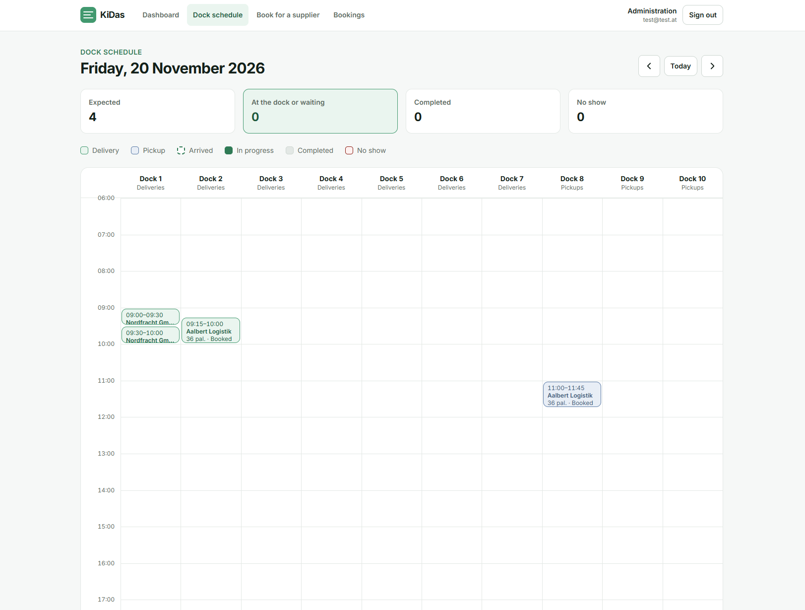
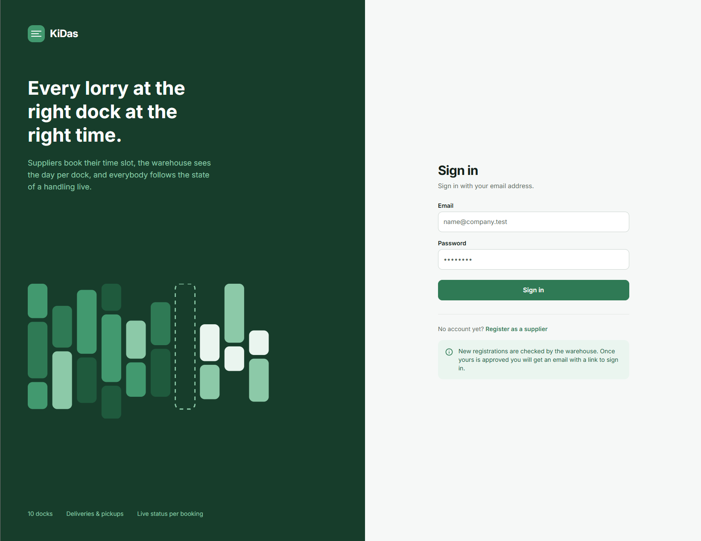
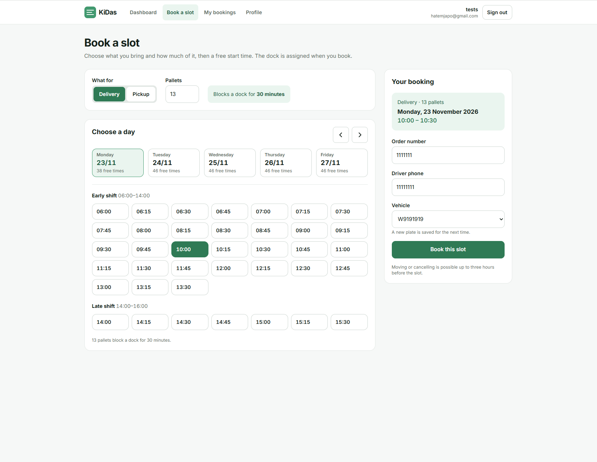
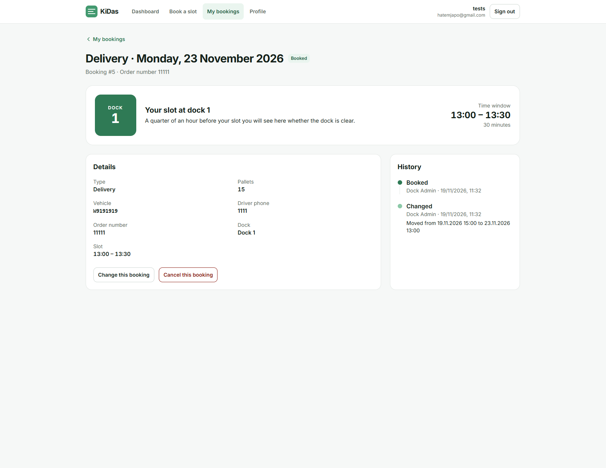

# KiDas – Dock Appointment System by kiyeog

A warehouse with **10 docks** receives deliveries every day and is approached by carriers for pickups. Without planning,
lorries queue at the gate while docks sit idle at other times. KiDas lets suppliers book a time window, gives the
warehouse the whole day per dock at a glance, and keeps every lorry's state visible to everyone who needs it.

[](https://kidas.kiyeog.com)



## Demo logins

The demo runs with made-up data. Sign in with one of these accounts and click around; the password is `password` for
all of them.

| Login | What you can do with it |
|---|---|
| `admin@kidas.test` | administration: book for a supplier, change or cancel any booking, keep days, docks and rules in the panel at `/admin` |
| `staff@kidas.test` | warehouse: the dock schedule, arrivals, the handling and no-shows |
| `nordfracht@kidas.test` | supplier: book a slot, follow it live, move or cancel it |
| `neuhaus@kidas.test` | a supplier whose registration is not approved yet — signing in is refused, which is the point |

Everything in there is demo data: companies, lorries and bookings are made up, and the day is laid out around the
current hour so the schedule and the live status have something to show. Please treat the accounts as shared — somebody
else may be looking at the same screen.

## The idea

A lorry that arrives unannounced costs the warehouse a dock and the driver an hour. KiDas sells the warehouse's time in
quarter-hour slices: the admin says which days are open and what each dock does in each shift, a supplier books a window
that fits their load, and the warehouse works the day off a single plan.

**The admin** keeps the master data — opening hours per weekday, the two shifts, how long a load of so many pallets
blocks a dock — releases days for booking and decides per day and shift what each dock serves, a delivery or a pickup.
They approve supplier registrations, and they may book, change or cancel for anybody at any time.

**The warehouse** does not book: it reads the day per dock, registers a lorry when it arrives, checks the plate against
the booking, starts the handling and reports the dock free again. A lorry that never turns up is marked as a no-show
once its slot is over.

**A supplier** registers, is approved, and books a delivery or a pickup with an order number, a pallet count, a lorry
and a driver phone. They never pick a dock — they pick a time, and the system assigns the dock when the booking is
saved. A quarter of an hour before the slot, the booking tells the driver whether the dock is clear.

A booking runs `booked → arrived → in progress → completed`, with `cancelled` and `no show` as the two ways out. Every
step is written into the booking's history with who did it and when.

**The rules that hold it together:** nothing is booked outside the opening hours or across a shift change; two bookings
never overlap on the same dock, while touching windows (one ends at 9:30, the next starts at 9:30) are fine; only
released days in the future are bookable; a supplier may move or cancel up to three hours before the slot, an admin at
any time; a dock's usage in a shift is fixed as soon as a booking sits on it; and a booking carries at most 70 pallets.

**Deliberately not in scope:** push notifications, dock attributes such as refrigeration, number-plate recognition, an
ERP or WMS connection, several warehouses, and more than one language.

## What it looks like

| | |
|---|---|
|  |  |
| The way in, with what KiDas does in one sentence. | A supplier picks the load, then a day and a start time; the dock comes with the booking. |



A quarter of an hour before the slot, the booking says whether the dock is clear — and the warehouse sees the same day
from the other side, in the schedule at the top of this file.

## Running it locally

```bash
composer install
cp .env.example .env
./vendor/bin/sail up -d
./vendor/bin/sail artisan key:generate
./vendor/bin/sail artisan migrate
./vendor/bin/sail artisan db:seed
./vendor/bin/sail npm install
./vendor/bin/sail npm run build
```

The application is then at **http://localhost:8080**, the admin panel at **/admin**, the API reference at **/docs**.
`db:seed` creates the same demo accounts as the live version, releases the coming two weeks and fills them with
bookings in every state; seeding again replaces its own bookings instead of adding a second set.

It needs Docker with Compose v2, plus PHP 8.4 and Composer to install the dependencies before the first start. Ports
live in `.env`: the app uses `APP_PORT=8080` and PostgreSQL is forwarded to `FORWARD_DB_PORT=5433`, because 80 and
5432 are often taken already. Times are stored in UTC and displayed in `Europe/Berlin`, so `APP_TIMEZONE` stays `UTC`.
For development, `./vendor/bin/sail npm run dev` replaces the build with Vite's dev server; `./vendor/bin/sail down`
stops everything.

## The endpoints

Every endpoint is described in [`docs/openapi.yaml`](docs/openapi.yaml), and the running application serves it as a
Swagger page at **/docs**. The file is written by hand rather than generated from annotations, so the controllers stay
free of documentation blocks — and a test holds it to the code: every route under `/api/v1` has to appear in the
specification with its methods, and nothing may appear there that the application does not serve. Try-it-out is
switched off, because the API authenticates with a session cookie and a CSRF header rather than a token.

## Tests and code quality

| | |
|---|---|
| Pest (feature + unit) | 677 tests |
| Vitest (React) | 318 tests |
| Static analysis | Larastan, zero errors |
| Style | Pint |

```bash
./vendor/bin/sail artisan test                        # Pest
./vendor/bin/sail npm test                            # Vitest
./vendor/bin/sail php vendor/bin/phpstan analyse      # Larastan
./vendor/bin/pint                                     # code style
```

Tests run with Pest against the `testing` database, which the PostgreSQL container creates on first start. The React
side is tested with Vitest and Testing Library; those tests live in `tests/js`. Static analysis runs inside the
container because PHPStan needs more memory than a typical local CLI configuration provides.

Every pull request runs on GitHub Actions in three jobs: `Quality` (Pint, Larastan), `Tests` (Pest against a PostgreSQL
service, building the frontend first because the SPA view needs the Vite manifest) and `Frontend` (`npm ci`,
`npm run build` and `npm test`).

The domain rules carry the weight of the suite: the slot grid across a daylight saving change, the three layers against
a double booking, every status transition and every refusal, the role matrix across all endpoints, and the
mass-assignment probes. Two tests exist to stop the documentation drifting away from the code: one holds
`docs/openapi.yaml` to the registered routes, the other holds the frontend's status map to the `BookingStatus` enum.

## How this was built

The whole application was written with **Claude Code** (Claude Opus 5) as the only AI tool, story by story along the
plan in [`docs/kidas.md`](docs/kidas.md) — eleven epics, each cut into stories small enough to review in one sitting.

Every story followed the same loop: the agent proposed a plan (files, approach, tests) and waited for a decision, then
implemented it with tests, then ran Pint, Larastan, Pest and Vitest, then reported — and only on an explicit instruction
committed, pushed and opened a pull request. Nothing was merged without the pipeline being green. The
[pull requests](https://github.com/hatemjapo/kidas/pulls?q=is%3Apr+is%3Amerged) are the history of that work, one per
story, each with what changed and why.

Two habits did most of the quality work. **Negative probes:** after writing a test, the rule under test was broken on
purpose to see the test fail — a test that stays green while the rule is gone is worth nothing, and several were
rewritten because of it. **Measuring instead of assuming:** the database was asked with `psql`, the built CSS was
grepped for the classes it should contain, vendor source was read rather than guessed at.

The instructions the agent worked under are in [`CLAUDE.md`](CLAUDE.md): business logic only in services and actions,
input only through form requests, output only through API resources, authorization through policies with a role test
for every new route, times stored in UTC, half-open intervals, deadlines from `config/booking.php` instead of magic
numbers, no comments in code.

## Where the AI got it wrong

## Architecture decisions

**API-first with a panel beside it.** Suppliers and the warehouse work through the API and the React app; the admin
works in Filament directly on the domain services. Both paths call the same service classes, so a rule exists once.

**The system assigns the dock.** A supplier picks a time, never a dock; the lowest free dock of the right usage is
assigned under lock when the booking is saved. Simpler to use, and no race for a favourite dock.

**Deadlines and limits in configuration.** The three-hour deadline, the maximum of 70 pallets, the live-status window
and the rate limits live in `config/booking.php`. There is no booking horizon: what is released is bookable.

## Known limitations

KiDas is a demonstration. It is meant to be reachable by anyone, with the demo logins above, so people can click through
it — there is no real company data in it, and that shapes what was built and what was left out.

## Stack

| Part | Choice |
|---|---|
| Backend | Laravel 13, API-first (`/api/v1`) |
| Auth | Sanctum (SPA cookie auth) |
| Frontend | React 19 + Tailwind 4 via Vite, React Router (`resources/js`) |
| Admin panel | Filament 5 (`/admin`, admin role only) |
| Database | PostgreSQL 18 via Laravel Sail |
| Tests | Pest (feature + unit) |
| Quality | Pint, Larastan, GitHub Actions |

## Roles

Three roles live in `App\Enums\UserRole`. Admins work in the Filament panel, warehouse staff and suppliers work in the React app, and all three share the same API.

| | Admin | Warehouse staff | Supplier |
| --- | --- | --- | --- |
| Filament panel | yes | no | no |
| App shell | yes | yes | yes |
| Dock schedule | yes | yes | no |
| Bookings | yes | no | own only |

Three gates keep that apart, each at its own level. `canAccessPanel()` decides who reaches Filament. The `role` middleware closes an API route to foreign roles (`->middleware('role:staff')`), answering `401` for a guest and `403` for the wrong role. Policies decide what somebody may do with a single record; `SupplierPolicy` is the first one, and the panel asks it before offering the decision buttons. Which records a role may see at all — a supplier sees only their own bookings — stays with the policies as well.

`tests/Feature/RouteMatrixTest.php` walks every route that exists today with every role and holds the expected answer, so a new route that forgets its gate shows up there.

In the browser the router repeats the same rules: the navigation only shows what a role may open, and typing a foreign path into the address bar lands on a page that says it belongs to another role and offers the way back. The browser side is convenience, not protection — the API decides.
